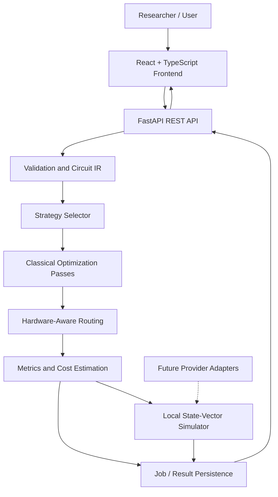

# ⚛️ QOptiQ

**AI-guided, hardware-aware quantum circuit optimization and transpilation platform.**

QOptiQ takes a quantum circuit, looks at the connectivity and error profile of a target device, picks a compilation strategy, applies optimization and routing passes, and reports how the circuit improved. It ships as a **FastAPI backend** with a **React + Vite dashboard**.

> [!NOTE]
> QOptiQ is a **research / educational MVP**. Fidelity and error numbers are analytic estimates, the strategy selector is a heuristic unless you supply a trained model, and real quantum hardware submission is **not** enabled. See [Implemented vs. Not Implemented](#-implemented-vs-not-implemented).

---

## 📌 Overview

Quantum hardware has limited qubit connectivity, restricted native gate sets and non-trivial error rates. A circuit written for an ideal machine usually has to be rewritten before it can run on a real device, and every extra gate or SWAP costs fidelity.

QOptiQ addresses this by:

- Representing circuits in a **provider-independent intermediate representation (IR)**.
- Applying **optimization passes** that remove redundant gates.
- **Routing** two-qubit gates onto a device's coupling map by inserting SWAPs.
- **Selecting a strategy** from circuit features and hardware properties.
- Computing **before/after metrics** so the effect of every pass is visible.
- Running small circuits on a **local state-vector simulator**.
- Tracking long-running work through a **persistent job queue** (SQLite).

The project is built using **Python**, **FastAPI**, **NumPy**, **Scikit-learn**, **React**, **TypeScript** and **Vite**.

---

## 🚀 Features

### Circuit Handling

- JSON circuit IR with validation
- Limited **OpenQASM 2** parser
- Gate and measurement checks, qubit-range checks

### Compiler Passes

- Adjacent inverse-gate cancellation
- Same-axis rotation merging
- Shortest-path SWAP insertion against a hardware coupling map

### Hardware Profiles

- Configurable qubit count, coupling map and basis gates
- Per-gate (1q / 2q) and readout error rates
- Built-in sample profiles: `line-5` and `fully-connected-5`
- Custom profiles accepted per request

### AI-Guided Strategy Selection

- Objectives: `balanced`, `minimum_gates`, `minimum_depth`, `minimum_error`
- Strategies: `balanced`, `aggressive`, `depth`, `noise_aware`
- Loads a trained scikit-learn model (`joblib`) when available, otherwise falls back to a transparent heuristic

### Metrics

- Gate count, two-qubit gate count, circuit depth, SWAP count
- Estimated error and estimated fidelity
- Compile time (ms)

### Execution & Jobs

- Local NumPy state-vector simulator (capped at 20 qubits)
- Asynchronous jobs with status polling
- SQLite job persistence

### Interactive Dashboard

Built with React, Recharts and Lucide icons:

- Circuit editor
- Hardware profile selection
- Objective selection and one-click optimization
- Optimized circuit JSON, metrics and charts
- Backend health indicator

---

## 🏗️ System Architecture




The compiler core only talks to the internal IR, so new providers can be added behind the adapter interface without touching the optimizer or the UI.

---

## 📂 Project Structure

```text
QOptiQ/
├── code/
│   ├── app/
│   │   ├── main.py              # FastAPI app and routes
│   │   ├── api/
│   │   │   └── schemas.py       # Pydantic request/response models
│   │   ├── compiler/
│   │   │   ├── ir.py            # Circuit IR and QASM2 parser
│   │   │   ├── optimizer.py     # Optimization and routing passes
│   │   │   ├── hardware.py      # Hardware profiles and sample devices
│   │   │   └── metrics.py       # Gate/depth/error/fidelity metrics
│   │   ├── ai/
│   │   │   └── strategy.py      # Strategy selector (model + heuristic)
│   │   ├── adapters/
│   │   │   ├── base.py          # Backend interface
│   │   │   ├── simulator.py     # Local state-vector simulator
│   │   │   ├── ibm.py           # IBM Quantum placeholder
│   │   │   └── braket.py        # Amazon Braket placeholder
│   │   └── jobs/
│   │       └── store.py         # SQLite-backed job store
│   ├── frontend/                # React + TypeScript + Vite dashboard
│   ├── tests/
│   │   └── test_backend.py
│   ├── Dockerfile
│   ├── docker-compose.yml
│   ├── QOptiQ.bat               # Windows setup and launcher
│   ├── .env.example
│   └── requirements.txt
├── docs/
│   ├── PROJECT_REPORT.md
│   ├── CONTRIBUTING.md
│   ├── CODE_OF_CONDUCT.md
│   └── SECURITY.md
└── README.md
```

---

## 🧠 How It Works

### 1. Submit a Circuit

Send a circuit as JSON (or QASM 2) together with an optional hardware profile and an objective.

```json
{
  "circuit": {
    "num_qubits": 3,
    "gates": [
      {"name": "H",  "qubits": [0]},
      {"name": "CX", "qubits": [0, 2]}
    ],
    "measurements": [0, 1, 2]
  },
  "objective": "balanced"
}
```

### 2. Choose a Strategy

The selector reads circuit features and hardware properties and returns a strategy together with the method used and a reason:

```text
Objective          → Strategy
minimum_gates      → aggressive
minimum_depth      → depth
minimum_error      → noise_aware
balanced           → noise_aware if 2q error > 0.008, else balanced
```

When a trained model exists at `QOPTIQ_MODEL_PATH`, it predicts the strategy from these features instead:

```text
[num_qubits, gate_count, two_qubit_ratio, connectivity_density, 2q_error, readout_error]
```

### 3. Optimize and Route

1. Cancel adjacent inverse gates
2. Merge same-axis rotations
3. Insert SWAPs along shortest paths so every two-qubit gate respects the coupling map

### 4. Inspect the Result

The response contains the compiled circuit, before/after metrics, the AI decision and the hardware profile used.

---

## 🔌 API

| Method | Endpoint | Description |
| ------ | -------- | ----------- |
| GET | `/health` | Service health |
| POST | `/circuits/validate` | Validate a circuit and return its metrics |
| POST | `/circuits/parse-qasm` | Parse OpenQASM 2 into the IR |
| GET | `/hardware` | List sample hardware profiles |
| POST | `/optimize` | Select a strategy, optimize and route |
| POST | `/transpile` | Alias of `/optimize` |
| POST | `/execute` | Run on the local simulator |
| POST | `/jobs` | Submit an asynchronous optimization job |
| GET | `/jobs/{id}` | Job status |
| GET | `/results/{id}` | Job result |
| GET | `/benchmarks` | Benchmark metadata |

Interactive documentation is available at `http://127.0.0.1:8000/docs` once the server is running.

Set `QOPTIQ_API_KEY` to require an `X-API-Key` header on every endpoint except `/` and `/health`. This is a **simple development guard**, not production authentication.

---

## ⚙️ Installation

Clone the repository:

```bash
git clone https://github.com/PrateekRaj8125/QOptiQ.git

cd QOptiQ/code
```

### Option 1: Run Locally

#### Backend

```bash
python -m venv .venv

# Windows:       .venv\Scripts\activate
# Linux / macOS: source .venv/bin/activate

./QOptiQ.bat
```

Open:

```text
http://127.0.0.1:8000/docs
```

> [!NOTE]
> Windows users can run `QOptiQ.bat` from the `code` folder to create the virtual environment, install dependencies and start the backend in one step.

#### Frontend

In a second terminal:

```bash
cd QOptiQ/code/frontend

npm install

npm run dev
```

Open:

```text
http://localhost:5173
```

### Option 2: Docker

```bash
cp .env.example .env

docker compose up --build
```

| Service | URL |
| ------- | --- |
| Frontend | http://localhost:8080 |
| API | http://localhost:8000 |

A trained strategy model, if you have one, is mounted read-only from `./models`.

---

## 🔧 Configuration

Copy `.env.example` to `.env` and adjust:

| Variable | Purpose |
| -------- | ------- |
| `QOPTIQ_API_KEY` | When set, requests must send a matching `X-API-Key` header |
| `QOPTIQ_SQLITE_PATH` | Location of the SQLite job database |
| `QOPTIQ_MODEL_PATH` | Path to an optional trained strategy model (`.joblib`) |
| `CORS_ORIGINS` | Comma-separated list of allowed browser origins |
| `IBM_QUANTUM_TOKEN` | Reserved for the future IBM Quantum integration |
| `IBM_BACKEND_NAME` | Reserved for the future IBM Quantum integration |

> [!WARNING]
> `.env.example` ships with `CORS_ORIGINS=*` for convenience. Restrict it to your real frontend origin before exposing the API beyond your own machine.

---

## 🧪 Running Tests

```bash
cd code

pytest -q
```

---

## ✅ Implemented vs. Not Implemented

**Implemented**

- IR validation and a limited OpenQASM 2 parser
- Adjacent inverse cancellation and same-axis rotation merging
- Shortest-path SWAP insertion
- Heuristic strategy selection (with optional trained-model hook)
- Approximate resource and error metrics
- Small NumPy state-vector simulator
- REST API, SQLite job persistence, Docker setup, React dashboard

**Not implemented**

- Global qubit remapping
- Full OpenQASM standard support
- Unitary resynthesis
- Hardware noise simulation
- Real IBM Quantum / Amazon Braket job submission (the adapter files are deliberate placeholders)
- PostgreSQL / Redis worker cluster
- A measured AI training dataset
- Comparative Qiskit / PennyLane benchmark runners

### Important Notes

- The simulator is capped at **20 qubits**.
- Estimated error and fidelity are **analytic estimates** from configured error rates, not device-measured values.
- The heuristic selector is **not** a trained scientific model. Use measured benchmark data before making research claims.

---

## 📈 Future Enhancements

- Trained strategy model built from measured benchmark data
- Real IBM Quantum and Amazon Braket execution
- Global qubit remapping and unitary resynthesis
- Noise-aware simulation
- Qiskit / PennyLane comparison benchmarks
- Full OpenQASM 2 / 3 support
- PostgreSQL + Redis worker architecture
- Authentication and role-based access
- Cloud deployment

---

## 🛠️ Tech Stack

**Backend**

- Python
- FastAPI
- Pydantic
- NumPy
- Scikit-learn
- Joblib
- SQLite
- Pytest

**Frontend**

- React
- TypeScript
- Vite
- Recharts
- Lucide React

**DevOps**

- Docker
- Docker Compose

---

## 👥 Team

QOptiQ is organised as a six-member project: three backend and three frontend roles.

| Role | Focus |
| ---- | ----- |
| Backend 1 | Quantum compiler |
| Backend 2 | AI / ML research |
| Backend 3 | Platform & infrastructure |
| Frontend 1 | Circuit designer |
| Frontend 2 | Hardware & optimization UI |
| Frontend 3 | Analytics & research dashboard |

See [`docs/PROJECT_REPORT.md`](docs/PROJECT_REPORT.md) for the full project report and individual contributions.

---

## 🤝 Contributing

Contributions are welcome. Please read:

- [Contributing Guidelines](docs/CONTRIBUTING.md)
- [Code of Conduct](docs/CODE_OF_CONDUCT.md)
- [Security Policy](docs/SECURITY.md)

---

## 📄 License

This project is licensed under the MIT License.

You are free to use, modify, and distribute this software with proper attribution.

See the [LICENSE](https://github.com/PrateekRaj8125/QOptiQ/blob/main/LICENSE) file for full details.

---

## 👨‍💻 Author

### Prateek Raj

Computer Science Student

Machine Learning & Quantum Computing Enthusiast
