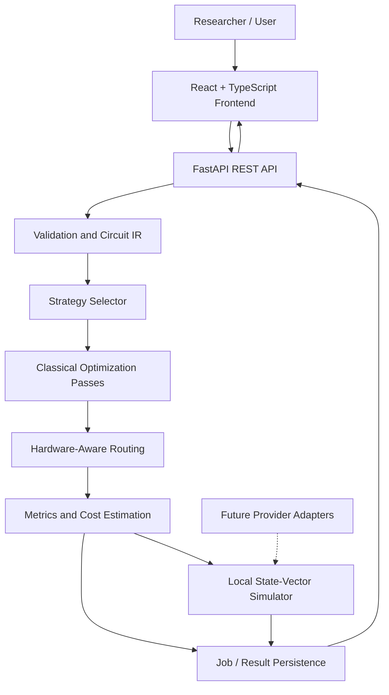

# QOptiQ — AI-Powered Quantum Circuit Optimization & Hardware-Aware Transpilation

**Project Report — KIIT Deemed to be University**  
**School of Computer Science and Engineering, Bhubaneswar, Odisha – 751024**

> Replace every `[PLACEHOLDER]` before submission. This report follows the supplied KIIT project-report template structure. The supplied template specifies Times New Roman, 12 pt, A4 page format and 1.5 line spacing for the final formatted report; Markdown cannot enforce those page-layout settings.

---

## Cover Page

**A PROJECT REPORT ON**  
# “QOptiQ: AI-Powered Quantum Circuit Optimization & Hardware-Aware Transpilation”

Submitted to KIIT Deemed to be University in partial fulfilment of the requirements for the award of the Bachelor’s Degree in Computer Science & Engineering.

**BY**

| Group member | Roll number | Responsibility |
|---|---|---|
| [GROUP MEMBER 1] | [ROLL NUMBER 1] | Backend 1 — Quantum Compiler |
| [GROUP MEMBER 2] | [ROLL NUMBER 2] | Backend 2 — AI/ML Research |
| [GROUP MEMBER 3] | [ROLL NUMBER 3] | Backend 3 — Platform & Infrastructure |
| [GROUP MEMBER 4] | [ROLL NUMBER 4] | Frontend 1 — Circuit Designer |
| [GROUP MEMBER 5] | [ROLL NUMBER 5] | Frontend 2 — Hardware & Optimization UI |
| [GROUP MEMBER 6] | [ROLL NUMBER 6] | Frontend 3 — Analytics & Research Dashboard |

**UNDER THE GUIDANCE OF**  
[PROJECT GUIDE NAME]

School of Computer Science and Engineering  
Kalinga Institute of Industrial Technology  
Bhubaneswar, Odisha – 751024  
[MONTH YEAR]

---

## Certificate

This is to certify that the project entitled **“QOptiQ: AI-Powered Quantum Circuit Optimization & Hardware-Aware Transpilation”**, submitted by the six students listed on the cover page, is a record of work carried out by them in partial fulfilment of the requirements for the award of the Bachelor of Engineering degree in Computer Science & Engineering at KIIT Deemed to be University, Bhubaneswar, during [ACADEMIC YEAR], under our guidance.

**Date:** [DD/MM/YYYY]

**[PROJECT GUIDE NAME]** — Project Guide  
[DEPARTMENT / DESIGNATION]  
*Signature and institutional seal to be added by the department.*

---

## Acknowledgements

We express our sincere gratitude to **[PROJECT GUIDE NAME]**, School of Computer Science and Engineering, KIIT Deemed to be University, for guidance, constructive feedback and encouragement throughout the project. We thank the faculty and department for providing the academic environment and resources required for this work. We also acknowledge the open-source communities and maintainers of the software frameworks used in the implementation. Finally, we thank our teammates for their collaboration in planning, implementation, testing and documentation.

**Signatures:** [MEMBER 1] · [MEMBER 2] · [MEMBER 3] · [MEMBER 4] · [MEMBER 5] · [MEMBER 6]

---

## Abstract

Quantum circuit compilation must account for circuit structure as well as the connectivity and error characteristics of the target quantum processor. A compilation strategy that works well for one circuit or hardware topology may be inefficient for another. QOptiQ is designed as a research-oriented platform that accepts quantum circuits, analyses circuit and hardware characteristics, selects an optimization strategy, applies classical optimization and hardware-aware routing, and presents before-and-after resource estimates. The platform uses a provider-independent circuit representation and a modular architecture intended to support multiple simulators and quantum hardware providers.

The current MVP includes a React and TypeScript user interface, a FastAPI service, circuit validation, a restricted OpenQASM 2 parser, baseline gate simplification, shortest-path routing, analytical resource/error estimation, a heuristic strategy selector, and a small local state-vector simulator. This implementation is a foundation for the larger research plan; it does not yet include a trained AI model, complete provider integrations, production-grade distributed jobs or experimentally validated quantum hardware results. These limitations are identified so that subsequent work can evaluate the research hypothesis using reproducible benchmarks.

**Keywords:** Quantum Computing, Quantum Circuit Optimization, Quantum Transpilation, Hardware-Aware Compilation, Artificial Intelligence, Quantum Circuit Routing, Compiler Benchmarking.

---

## Contents

1. Introduction
2. Basic Concepts / Literature Review
3. Problem Statement / Requirement Specifications
4. Implementation
5. Standards Adopted
6. Conclusion and Future Scope
7. References
8. Individual Contribution
9. Plagiarism Report

---

# Chapter 1 — Introduction

Quantum computing uses quantum-mechanical states and operations to process information. A quantum algorithm is commonly expressed as a circuit consisting of qubits, quantum gates and measurements. Before execution, a circuit must be transformed to satisfy the instruction set and connectivity constraints of a target device. This process is generally called compilation or transpilation.

Quantum hardware is heterogeneous. Devices may differ in their number of qubits, coupling topology, supported basis gates, gate duration and error characteristics. A logical two-qubit operation may not be directly executable when its qubits are not connected on the target device. Routing can therefore introduce SWAP operations, increasing circuit size and potentially increasing accumulated error. A fixed compilation strategy may not be equally effective for every combination of circuit and hardware.

QOptiQ addresses this problem by proposing an AI-guided, hardware-aware compilation workflow. The platform is intended to analyse circuit features and hardware properties, select a suitable compilation strategy, apply optimization passes and provide interpretable comparisons against the original circuit and baseline approaches. Its central design principle is separation between the compiler's internal circuit representation and external quantum providers. This makes it possible to add or replace providers without redesigning the user interface or core optimization logic.

The current implementation is a minimum viable platform. It demonstrates the user workflow, provider-neutral data model, baseline transformations, API integration and local simulation. The AI selector is presently a heuristic fallback and must not be described as a trained model. Hardware error calculations are analytical estimates rather than measurements from a physical QPU. The remainder of this report introduces the underlying concepts, specifies requirements and architecture, documents the current implementation and defines testing and future research work.

---

# Chapter 2 — Basic Concepts / Literature Review

## 2.1 Quantum Circuits

A quantum circuit is an ordered sequence of quantum gates applied to a register of qubits. Single-qubit gates act on one qubit, while multi-qubit gates such as controlled-NOT (CX) and controlled-Z (CZ) act on two or more qubits. Measurements convert quantum states into classical outcomes. QOptiQ's current internal representation stores the number of qubits, ordered gate operations, gate parameters, measurements and metadata.

## 2.2 Quantum Circuit Compilation and Transpilation

Transpilation transforms a logical circuit into a form executable by a target device. Typical stages include circuit validation, gate decomposition, optimization, qubit mapping and routing. The target hardware's basis gates and coupling map constrain the transformations that can be applied.

## 2.3 Hardware Topology and Routing

A coupling map is represented as a graph in which vertices denote physical qubits and edges denote permitted two-qubit interactions. If two logical qubits are mapped to non-adjacent physical qubits, routing may insert SWAP gates to move quantum states along a path. QOptiQ's MVP uses a shortest-path routing baseline; global qubit mapping and advanced routing heuristics remain future work.

## 2.4 Circuit Optimization

Optimization attempts to reduce resource requirements while preserving circuit semantics. The MVP implements adjacent inverse-gate cancellation for selected self-inverse gates and merging of adjacent rotations around the same axis on the same qubit. More advanced techniques such as commutation-aware rewriting, gate fusion, unitary resynthesis and pulse-level optimization are outside the current implementation.

## 2.5 AI-Guided Strategy Selection

The research plan proposes learning which compilation strategy performs best for a circuit-hardware pair. Candidate features include qubit count, gate count, gate distribution, two-qubit ratio, interaction density, hardware connectivity and error rates. Candidate supervised models include Random Forest, XGBoost and multilayer perceptrons; graph neural networks and reinforcement learning are advanced extensions. The delivered selector uses a deterministic heuristic fallback. A trained model, dataset, model validation and generalization study are still required.

## 2.6 Performance and Error Metrics

The platform reports gate count, one-qubit and two-qubit gate counts, circuit depth, SWAP count, compilation time, estimated error and estimated fidelity. The current error estimator applies configured independent gate-error rates to a simplified survival-probability calculation. It does not model correlated noise, crosstalk, calibration drift, readout mitigation or device-specific execution effects.

## 2.7 Software Technologies

- **React and TypeScript:** component-based frontend and typed application logic.
- **Vite:** frontend development server and production build tool.
- **FastAPI and Pydantic:** REST API, request validation and OpenAPI documentation.
- **NumPy:** state-vector operations in the local simulator.
- **scikit-learn / joblib:** optional model-loading path for strategy selection.
- **SQLite:** lightweight job persistence in the MVP.
- **Docker and Docker Compose:** repeatable container packaging.

---

# Chapter 3 — Problem Statement / Requirement Specifications

## 3.1 Problem Statement

Given a quantum circuit and a target hardware profile, determine and apply an appropriate compilation strategy that reduces circuit resource cost while respecting hardware connectivity and making the trade-offs understandable to the user. The platform should provide an extensible architecture in which AI models and quantum execution providers can be added without coupling them directly to the frontend.

**Research hypothesis:** An AI-guided hardware-aware compilation strategy can reduce quantum circuit resource requirements and estimated execution error compared with fixed transpilation strategies across heterogeneous circuit and hardware configurations. This hypothesis requires systematic experiments and is not claimed as proven by the MVP.

**Research questions**
1. Can a model predict an effective optimization strategy for a circuit-hardware pair?
2. How does strategy selection affect gate count, two-qubit gates, depth and SWAP operations?
3. Can optimization improve estimated execution fidelity under a defined hardware error model?
4. Does a model generalize to unseen circuit families and hardware topologies?
5. What compilation-time overhead is introduced by model inference?
6. What trade-offs occur when optimizing multiple objectives simultaneously?

## 3.2 Project Planning

The six-member plan divides the work into three backend and three frontend roles.

| Phase | Indicative weeks | Milestone |
|---|---:|---|
| Foundation | 1–2 | Repository, architecture, circuit IR, UI shell and API skeleton |
| Classical compiler | 3–5 | Optimization passes, hardware model, routing and initial dashboard |
| AI optimizer | 6–9 | Dataset, feature extraction, baseline ML and strategy selection |
| Hardware integration | 10–12 | Simulator and provider adapters, execution workflow |
| Research | 13–16 | Benchmarking, generalization and multi-objective experiments |
| Production | 17–20 | Docker, CI/CD, cloud deployment, security and documentation |

### Functional requirements

- FR-01: The user shall provide a circuit using the documented circuit JSON schema.
- FR-02: The system shall validate qubit indices, gate names, gate arity and rotation parameters.
- FR-03: The system shall expose hardware profiles and topology information.
- FR-04: The user shall select an optimization objective.
- FR-05: The backend shall return the optimized circuit and before/after metrics.
- FR-06: The system shall provide local simulator execution for supported circuits.
- FR-07: The system shall expose job status and completed results.
- FR-08: The user shall inspect the selected strategy and compiler explanation.
- FR-09: The frontend shall display API connectivity and validation errors.

### Non-functional requirements

- NFR-01: Compiler core data structures shall remain provider-independent.
- NFR-02: API request and response formats shall be documented through OpenAPI.
- NFR-03: The system shall validate external circuit input before compilation.
- NFR-04: Configuration and credentials shall be supplied through environment variables.
- NFR-05: Components shall be modular and independently testable.
- NFR-06: Deployment shall be reproducible through documented setup and Docker packaging.
- NFR-07: Research results shall distinguish estimates from measured QPU observations.

## 3.3 System Design

### 3.3.1 Design Constraints

**Software environment:** Python 3.12 or a compatible supported version, Node.js 20 or later, React, TypeScript, FastAPI, NumPy, SQLite and Docker.

**Hardware environment:** A standard development computer capable of running the API and frontend. The state-vector simulator is limited to 20 qubits in this implementation; memory requirements grow exponentially with qubit count.

**Research constraints:** Physical quantum hardware access is optional. Simulated hardware profiles can be used for reproducible initial experiments. No physical-QPU performance claim should be made without recorded provider execution evidence.

**Implementation constraints:** The QASM parser accepts only a restricted subset. The routing algorithm is a shortest-path baseline. The AI selector is heuristic unless a compatible model is supplied.

### 3.3.2 System Architecture / Block Diagram

The frontend submits a circuit, target profile and objective to the API. The backend validates the input and converts it to a provider-neutral internal representation. A strategy selector recommends a compilation strategy; optimization and routing passes transform the circuit. The metrics module calculates resource and estimated-error information. The local simulator can execute supported circuits. Results are returned to the frontend. Future provider adapters are intended to implement the same backend interface.

### 3.3.3 Major Modules

| Module | Responsibility |
|---|---|
| `app/compiler/ir.py` | Circuit and gate data structures, validation and restricted QASM parser |
| `app/compiler/optimizer.py` | Baseline simplification and shortest-path routing |
| `app/compiler/hardware.py` | Hardware profile and coupling-map model |
| `app/compiler/metrics.py` | Circuit depth, gate statistics and analytical error estimate |
| `app/ai/strategy.py` | Heuristic strategy selector and optional model-loading hook |
| `app/adapters/simulator.py` | Local NumPy state-vector simulator |
| `app/adapters/ibm.py` | Future IBM provider extension point; not live execution |
| `app/adapters/braket.py` | Future Braket provider extension point; not live execution |
| `app/jobs/store.py` | SQLite job persistence |
| `app/main.py` | REST API and application wiring |
| `frontend/src/App.tsx` | Circuit editor, hardware selection and result interface |

---

# Chapter 4 — Implementation

## 4.1 Methodology / Proposal

The MVP follows a modular compilation pipeline:

1. Accept circuit JSON and validate its structure.
2. Select a hardware profile and optimization objective.
3. Extract basic circuit and hardware features.
4. Select a strategy using a heuristic fallback or optional loaded model.
5. Apply adjacent inverse-gate cancellation and adjacent same-axis rotation merging.
6. Route non-adjacent two-qubit gates using a shortest-path coupling graph.
7. Calculate before-and-after resource metrics and simplified error estimates.
8. Return the transformed circuit, metrics and explanation.
9. Optionally execute a supported circuit using the local state-vector simulator.

### Multi-objective cost function

The research plan may use a weighted cost function:

\[
C = w_g G + w_d D + w_s S + w_e E
\]

where \(G\) is gate count, \(D\) is circuit depth, \(S\) is SWAP count, \(E\) is the selected error estimate, and \(w_g,w_d,w_s,w_e\) are configurable weights. Normalization and weight calibration should be completed before comparative research.

## 4.2 Testing / Verification Plan

The following cases define the minimum verification plan. Replace each status after executing tests in the team's environment.

| Test ID | Test case | Test condition | Expected result | Status |
|---|---|---|---|---|
| T01 | Valid circuit validation | Valid qubit count and supported gates | Circuit accepted | [NOT RUN / PASS / FAIL] |
| T02 | Invalid qubit index | Gate references qubit outside circuit | Validation error | [STATUS] |
| T03 | Unsupported gate | Gate name not supported | Validation error | [STATUS] |
| T04 | Inverse gate cancellation | Adjacent H-H or CX-CX pair | Pair removed | [STATUS] |
| T05 | Rotation merging | Adjacent RZ rotations on same qubit | Angles combined modulo \(2\pi\) | [STATUS] |
| T06 | Hardware routing | Two-qubit gate on non-adjacent nodes | Routing SWAPs inserted where path exists | [STATUS] |
| T07 | Disconnected topology | No path between interaction qubits | Clear compilation error | [STATUS] |
| T08 | Simulator Bell circuit | H on q0 followed by CX(q0,q1) | Counts concentrated on 00 and 11 | [STATUS] |
| T09 | API health | GET `/health` | Service status returned | [STATUS] |
| T10 | Frontend build | `npm run build` | Production assets generated | [STATUS] |
| T11 | Docker startup | `docker compose up --build` | API and web containers start | [STATUS] |
| T12 | API key guard | Configure key and send missing/invalid key | Protected endpoint rejects request | [STATUS] |

## 4.3 Result Analysis / Screenshots

The uploaded project archive contained an existing FastAPI backend with circuit IR, baseline optimizer, hardware profiles, metrics, heuristic strategy selection, local simulator, SQLite jobs and API routes. This delivery adds a React/TypeScript interface and deployment scaffolding around that backend.

**Insert actual screenshots after running the application:**

- Figure 4.1: QOptiQ workspace view — [INSERT SCREENSHOT]
- Figure 4.2: Circuit JSON editor and hardware selection — [INSERT SCREENSHOT]
- Figure 4.3: Optimization summary with before/after metrics — [INSERT SCREENSHOT]
- Figure 4.4: Local simulator output for Bell-state circuit — [INSERT SCREENSHOT]
- Figure 4.5: API documentation at `/docs` — [INSERT SCREENSHOT]

No validated comparative benchmark dataset or physical QPU measurements were supplied with the project archive. Therefore, no numerical optimization gains are asserted in this report. Populate this section only after controlled experiments against the same circuits, profiles, objectives and compiler settings.

Recommended comparison: Original circuit, Qiskit baseline, PennyLane baseline, QOptiQ classical and QOptiQ AI. Record gate count, depth, two-qubit gates, SWAPs, estimated error/fidelity, compilation time, model version and hardware-profile version. Keep training, validation and final test circuits separate.

## 4.4 Quality Assurance

Quality assurance activities include input validation, modular code organization, unit testing of compiler transformations, API contract testing, frontend production builds, container startup verification and reproducible benchmark configuration. Before public deployment, add authentication and authorization, rate limiting, secure secret storage, dependency scanning, structured logs, monitoring, backups and a security review.

---

# Chapter 5 — Standards Adopted

## 5.1 Design Standards

- Modular architecture with separation of concerns.
- Provider-independent internal circuit representation.
- Explicit interfaces for simulator and hardware providers.
- API resources and schemas documented using OpenAPI.
- Consistent naming for modules and data structures.
- Clear distinction between estimated and hardware-measured values.

## 5.2 Coding Standards

- Python: follow PEP 8 naming and formatting conventions.
- TypeScript: use strict typing and reusable components.
- Use descriptive identifiers and small, single-purpose functions.
- Validate external inputs at API boundaries.
- Keep secrets and environment-specific settings out of source control.
- Document non-obvious algorithms and assumptions.
- Use pull requests and peer review for integration.

## 5.3 Testing Standards

- Unit tests for circuit validation and each compiler pass.
- Integration tests for API-to-compiler and API-to-simulator flows.
- Frontend build and interaction verification.
- Regression tests for known circuit transformations.
- Repeated benchmark runs with fixed seeds where applicable.
- Report variability or confidence intervals when experimental results warrant them.

Formal ISO/IEC or IEEE standards should be mapped to the department's required list only after confirming the applicable edition and compliance scope; no formal certification is claimed here.

## 5.4 Cost Analysis

The MVP uses open-source frameworks and local simulation, so development can begin without paid quantum hardware access. The principal costs for a student project are development time, computing resources, optional cloud hosting, storage and provider-specific quantum execution charges. Actual cost figures should be added using the team's selected hosting provider and current pricing at deployment.

| Cost item | MVP approach | Cost entry |
|---|---|---|
| Frontend framework | React / TypeScript / Vite | [FREE / HOSTING COST] |
| Backend framework | FastAPI / Python | [FREE / HOSTING COST] |
| Local database | SQLite | [FREE] |
| Containerization | Docker Compose | [FREE / HOSTING COST] |
| Cloud hosting | [SELECT PROVIDER] | [INSERT CURRENT ESTIMATE] |
| Quantum hardware | Local simulator; optional provider | [INSERT IF USED] |

---

# Chapter 6 — Conclusion and Future Scope

## 6.1 Conclusion

QOptiQ establishes a modular foundation for AI-guided, hardware-aware quantum circuit compilation. The project connects a browser-based circuit workflow to a backend that validates circuits, applies baseline optimization, routes two-qubit operations against hardware connectivity, estimates resource metrics and supports local state-vector simulation. A provider-neutral internal representation reduces coupling between the compiler core and external quantum providers.

The delivered implementation demonstrates the software workflow but does not yet validate the central research hypothesis. The current AI selector is heuristic, the routing method is a baseline, error/fidelity metrics are simplified estimates, and external IBM/Braket execution is not enabled. A completed research evaluation will require a versioned dataset, trained and validated models, stronger compiler baselines, repeated experiments and analysis of generalization and compilation overhead.

## 6.2 Future Scope

1. Generate reproducible datasets from QAOA, VQE, Grover, QFT, variational/QML and random circuits.
2. Train Random Forest, XGBoost and MLP baselines for strategy selection.
3. Explore graph neural networks for joint circuit/hardware representations.
4. Investigate reinforcement learning after a supervised baseline is established.
5. Implement global qubit mapping, commutation-aware optimization and improved routing.
6. Add calibrated noise models and provider calibration data.
7. Implement real IBM Quantum and Amazon Braket adapters.
8. Replace SQLite/in-process background tasks with PostgreSQL and Redis-backed workers.
9. Add experiment versioning, MLflow tracking and exportable research reports.
10. Add secure multi-user deployment, CI/CD and optional Kubernetes/Terraform infrastructure.

---

# References

These are foundational references and official documentation starting points. Verify exact editions, page ranges, DOI metadata and citation style before final submission.

1. M. A. Nielsen and I. L. Chuang, *Quantum Computation and Quantum Information*, 10th Anniversary Edition, Cambridge University Press, 2010.
2. A. Barenco et al., “Elementary gates for quantum computation,” *Physical Review A*, vol. 52, pp. 3457–3467, 1995.
3. D. Maslov, “Basic circuit compilation techniques for an ion-trap quantum machine,” *New Journal of Physics*, vol. 19, 023035, 2017.
4. A. W. Cross et al., “OpenQASM 3: A broader and deeper quantum assembly language,” *ACM Transactions on Quantum Computing*, vol. 3, no. 3, 2022.
5. IBM Quantum, “Qiskit documentation.” https://docs.quantum.ibm.com/
6. PennyLane, “PennyLane documentation.” https://docs.pennylane.ai/
7. FastAPI, “FastAPI documentation.” https://fastapi.tiangolo.com/
8. React, “React documentation.” https://react.dev/
9. NumPy Developers, “NumPy documentation.” https://numpy.org/doc/

---

# Individual Contribution

The KIIT template requires a separate individual contribution report for every student, with the student's own role, planning, technical findings, report contribution and presentation/demo contribution. The following six entries are placeholders and must be individually completed and signed. The final individual report should meet the department's required length (the supplied template specifies at least one page per student).

## Member 1 — Backend 1: Quantum Compiler Engineer

**Name:** [STUDENT NAME] · **Roll Number:** [ROLL NUMBER]

**Common abstract:** QOptiQ is a platform for AI-guided quantum circuit optimization and hardware-aware transpilation. It analyses circuit and hardware properties, applies optimization and routing, and presents resource estimates.

**Individual contribution and findings:** [Describe IR design, parser, validation, optimization passes, routing algorithms, tests, technical challenges and findings.]

**Contribution to report preparation:** [Chapters / sections written or reviewed.]

**Presentation and demonstration contribution:** [Slides, live demo and questions handled.]

**Supervisor signature:** [SIGNATURE] · **Student signature:** [SIGNATURE]

## Member 2 — Backend 2: AI/ML Research Engineer

**Name:** [STUDENT NAME] · **Roll Number:** [ROLL NUMBER]

**Common abstract:** QOptiQ is a platform for AI-guided quantum circuit optimization and hardware-aware transpilation. It analyses circuit and hardware properties, applies optimization and routing, and presents resource estimates.

**Individual contribution and findings:** [Describe dataset generation, feature engineering, baseline models, evaluation and findings. Do not claim training results until completed.]

**Contribution to report preparation:** [Chapters / sections written or reviewed.]

**Presentation and demonstration contribution:** [Slides, live demo and questions handled.]

**Supervisor signature:** [SIGNATURE] · **Student signature:** [SIGNATURE]

## Member 3 — Backend 3: Platform & Infrastructure Engineer

**Name:** [STUDENT NAME] · **Roll Number:** [ROLL NUMBER]

**Common abstract:** QOptiQ is a platform for AI-guided quantum circuit optimization and hardware-aware transpilation. It analyses circuit and hardware properties, applies optimization and routing, and presents resource estimates.

**Individual contribution and findings:** [Describe API, schemas, jobs, database, provider adapters, containers, deployment and testing.]

**Contribution to report preparation:** [Chapters / sections written or reviewed.]

**Presentation and demonstration contribution:** [Slides, live demo and questions handled.]

**Supervisor signature:** [SIGNATURE] · **Student signature:** [SIGNATURE]

## Member 4 — Frontend 1: Quantum Circuit Designer

**Name:** [STUDENT NAME] · **Roll Number:** [ROLL NUMBER]

**Common abstract:** QOptiQ is a platform for AI-guided quantum circuit optimization and hardware-aware transpilation. It analyses circuit and hardware properties, applies optimization and routing, and presents resource estimates.

**Individual contribution and findings:** [Describe circuit editor, gate interactions, QASM import/export, visualization and UI testing.]

**Contribution to report preparation:** [Chapters / sections written or reviewed.]

**Presentation and demonstration contribution:** [Slides, live demo and questions handled.]

**Supervisor signature:** [SIGNATURE] · **Student signature:** [SIGNATURE]

## Member 5 — Frontend 2: Hardware & Optimization UI

**Name:** [STUDENT NAME] · **Roll Number:** [ROLL NUMBER]

**Common abstract:** QOptiQ is a platform for AI-guided quantum circuit optimization and hardware-aware transpilation. It analyses circuit and hardware properties, applies optimization and routing, and presents resource estimates.

**Individual contribution and findings:** [Describe hardware explorer, topology visualization, noise/cost view, objective controls and execution workflow.]

**Contribution to report preparation:** [Chapters / sections written or reviewed.]

**Presentation and demonstration contribution:** [Slides, live demo and questions handled.]

**Supervisor signature:** [SIGNATURE] · **Student signature:** [SIGNATURE]

## Member 6 — Frontend 3: Analytics & Research Dashboard

**Name:** [STUDENT NAME] · **Roll Number:** [ROLL NUMBER]

**Common abstract:** QOptiQ is a platform for AI-guided quantum circuit optimization and hardware-aware transpilation. It analyses circuit and hardware properties, applies optimization and routing, and presents resource estimates.

**Individual contribution and findings:** [Describe metric dashboard, charts, benchmark comparison, experiment history, report export and findings.]

**Contribution to report preparation:** [Chapters / sections written or reviewed.]

**Presentation and demonstration contribution:** [Slides, live demo and questions handled.]

**Supervisor signature:** [SIGNATURE] · **Student signature:** [SIGNATURE]

---

# Plagiarism Report

**Mandatory institutional attachment:** [INSERT ORIGINAL TURNITIN REPORT]

The supplied KIIT template states that the plagiarism report is mandatory and the similarity must be below 25%. The team must generate the report through the institution-approved process and attach the authentic result. No similarity percentage is asserted in this document.

---

## Final Submission Checklist

- [ ] Replace student, roll number, guide, academic-year and date placeholders.
- [ ] Verify references and add relevant peer-reviewed literature.
- [ ] Run backend tests and record actual outcomes.
- [ ] Build the frontend and record actual outcomes.
- [ ] Test Docker deployment from a clean checkout.
- [ ] Add actual screenshots and measured benchmark tables.
- [ ] Complete six distinct individual contribution reports.
- [ ] Attach signed certificate and acknowledgement pages as required.
- [ ] Attach the authentic Turnitin report and satisfy the department's similarity requirement.
- [ ] Format the final report in the required institutional layout (A4, Times New Roman, 12 pt, 1.5 spacing as specified by the supplied template).
